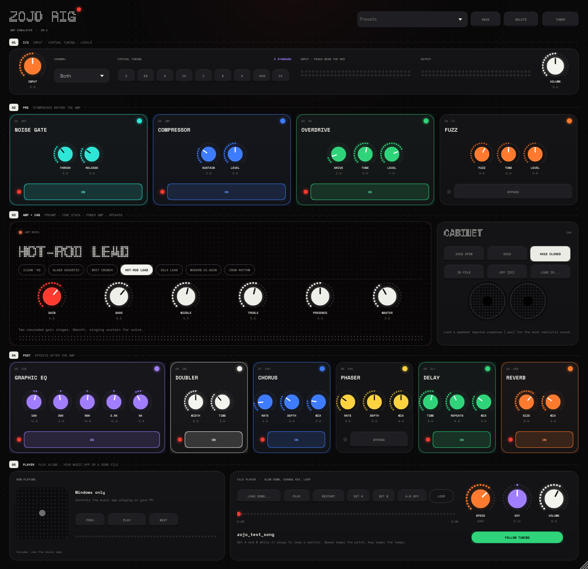

# ZOJO RIG



Guitar amp simulator: standalone Windows app + VST3 plugin, built with [JUCE](https://juce.com).

**Signal chain:** input (channel select) → virtual tuning → noise gate → compressor → overdrive → fuzz →
amp (7 models, 4× oversampled) → cabinet (3 sims or your own IR) → graphic EQ → doubler → chorus → phaser →
delay → reverb → volume. Built-in tuner, 36 level-matched factory presets + user presets.

**Player:** a Now Playing panel that shows and controls whatever music app is playing on Windows
(system media controls), and a file player with pitch-preserving slow-down, key change and A–B looping
(time-stretch by [Signalsmith Stretch](https://github.com/Signalsmith-Audio/signalsmith-stretch), MIT).

## Getting the app (no coding tools needed)
Every push to GitHub builds Windows automatically:
1. Open the **Actions** tab of this repository and click the latest **Build ZOJO RIG** run.
2. When it shows a green check (about 10–15 minutes), scroll to **Artifacts** and download **ZOJO-RIG-Windows**.
3. Unzip it and read `GETTING-STARTED.txt`.

To rebuild without changing anything: Actions → Build ZOJO RIG → **Run workflow**.

## Building locally (optional)
Requires Visual Studio 2022 (Desktop C++ workload) and CMake 3.22+:
```
cmake -S . -B build -A x64
cmake --build build --config Release
```
Output: `build/ZojoRig_artefacts/Release/Standalone/ZOJO RIG.exe` and `.../VST3/ZOJO RIG.vst3`.

## Project layout
- `Source/Dsp.h` – amp, cab, gate, pitch shifter, doubler, chorus, delay building blocks
- `Source/PluginProcessor.*` – parameters and the audio chain
- `Source/Presets.*` – factory banks and user preset files
- `Source/Player.*` – file player (decode, resample, time-stretch, A–B loop)
- `Source/NowPlaying*` – Windows media controls (C++/WinRT) + non-Windows stub
- `Source/PluginEditor.*`, `Source/UI/*` – the dark ZOJO interface
- `Tests/TestMain.cpp` – offline test runner (`-DZOJO_BUILD_TESTS=ON`)

## Licensing note
JUCE is used under its open-source AGPLv3 option and includes the ASIO SDK (GPLv3). That's fine for personal use.
Selling or distributing a closed-source version would need a commercial JUCE licence.
Fonts: Space Mono and Space Grotesk (SIL Open Font License, see `Resources/fonts`).
